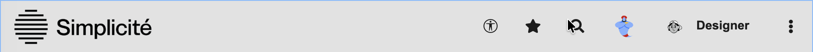
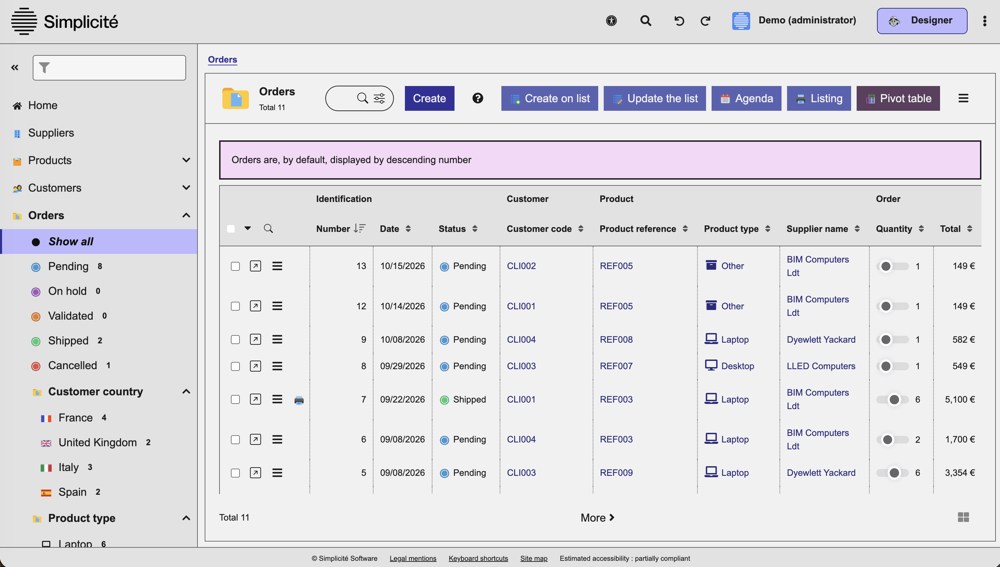
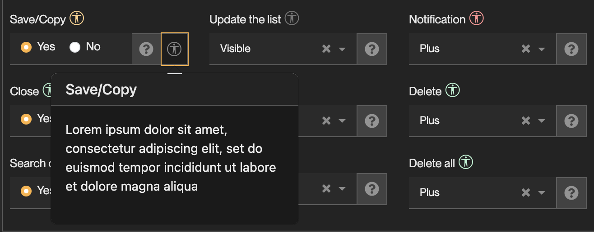

Create compliant applications with Simplicité
===========================================

Introduction
------------

This guide helps designers build Simplicité applications that meet the RGAA. It describes the tools the
platform provides to reach compliance, the platform-wide points that depend on your choices, and the
settings that a strictly compliant application requires.

It is meant to be used alongside the platform: keep it open while you configure your application.

Platform features
-----------------

| Feature | For | Purpose |
| --- | --- | --- |
| [`a11y-mode`](#runtime-a11y-mode) | End users | Runtime switch to the most RGAA-compliant version of the platform |
| [`ACCESSIBILITY_OVERRIDE`](#user-accessibility_override-parameter) | End users | Fine-tune which adaptations `a11y-mode` applies |
| [`ACCESSIBILITY_DEV`](#designer-accessibility_dev-sysparam) | Designers | Show the compliance status of each feature while you configure it |
| [`ACCESSIBILITY_LEVEL`](#accessibility-declarations) | Designers | Declare the accessibility level of your application |

### Runtime `a11y-mode`

End users toggle **Accessibility Mode** from the `.btn-a11y-mode` button in the application header.






Some core behaviors cannot be made compliant without degrading the comfort of users who do not need
them. `a11y-mode` adapts or disables them all at once, which makes it the most RGAA-compliant version
of the platform: in an audit, only use with `a11y-mode` on is guaranteed compliant for core elements.

| Behavior | What `a11y-mode` does |
| --- | --- |
| Custom colors of action buttons and states | All custom colors set on action buttons with the `act_bg_color` and `act_color` fields (Action form) |
| Horizontal menu | Forces all domains to be rendered on the left, disabling any `obd_menu` set to `T`. |
| Splitting the work area into resizable panels | Forcing the mono-area for the `#work`, and disabling the `btn-ui-splitter` so work-areas cannot be triggered. |
| Compact mode | Forcing the default compact setting (removing `compact` from the body), disabling the `zoom-compact` toggle. |
| Mosaic display of lists | Disabling all `btn-minifiable` in the lists `panel-footer`. Making them non-clickable when in a11y-mode. |
| Trays (trello) and metrics of status-based objects | Removing the statuses objects "Trays" (`status-tray`) and "Metrics" (`status-metrics`) entries from menu. |
| Predefined searches offered in the search dialog | Disabling the `predef` button from the search modal. |
| Date pickers | Removing all datetime pickers from fields and filters. Replacing them with a textual hint with proper formatting. |
| HTML input fields | Rendering all "complex" html fields as plain `textarea`, removing the specific features (linting, formatting, etc), but still allowing their usage. |
| Forced `HighContrast` theme | When in `a11y-mode`, switches the theme to be **HighContrast** (requires few settings to be effective, see [A11y-mode settings](#settings-for-a11y-mode)) |
| Opening a form per table row | Replaces the form-opening behavior from clicking on a row to an action button in the `col-action` of every row. |
| Default display of linked objects | Forces the `objlinks` display to be `objlinks-flow`, and disables the `btn-options` dropdown/action. |

:::warning

`a11y-mode` is a safety net: it does not make Non-Compliant features compliant. Under strict
requirements, disable them at design time, whether or not users turn the mode on.

:::

### User `ACCESSIBILITY_OVERRIDE` parameter

`a11y-mode` is all-or-nothing, so that it can reach full compliance. Users who do not need some of its
adaptations, or who want to keep some features anyway, can override it behavior by behavior with the
`ACCESSIBILITY_OVERRIDE` user parameter :

```json
{
  "customcolors": false,  // custom colors of action buttons and states
  "menutop": false,  // horizontal menu
  "workareas": false,  // splitting the work area into resizable panels
  "trays": false,  // trays (trello) of status-based objects
  "metrics": false,  // metrics of status-based objects
  "datepicker": false,  // date pickers
  "htmledit": false,  // HTML input fields
  "codeedit": false,  // code editors
  "theme": "ThemeHighContrast",  // forced HighContrast theme
  "clickablerow": false,  // opening a form per table row
  "flatlinks": false  // default display of linked objects
}
```

Each overridden behavior falls back to its standard, potentially non-compliant version for that user.

### Compliance statuses

The same vocabulary is used by the `ACCESSIBILITY_DEV` icons, by the `fld_compliance` field and across
this document.

| Status | Icon | `fld_compliance` | Meaning |
| --- | --- | --- | --- |
| **Compliant** <rgaa-c>(C)</rgaa-c> | green | `C` | Use freely. The feature meets the RGAA tests and WAI-ARIA rules. |
| **Partially Compliant** <rgaa-pc>(PC)</rgaa-pc> | orange | `PC` | Usable, but only with the settings given in its help popup (`fld_compliancehint`). |
| **Non-Compliant** <rgaa-nc>(NC)</rgaa-nc> | red | `NC` | Do not use under strict compliance requirements. |
| **Not Evaluated** | grey | `NE` | Not assessed yet. Avoid under strict requirements. |
| **Not Applicable** | none | `NA` | The feature has no bearing on RGAA compliance. |

### Designer `ACCESSIBILITY_DEV` sysparam

Set the `ACCESSIBILITY_DEV` system parameter to `yes` for the whole design phase. Every setting in the
configuration forms then shows an icon next to its label, giving the
[compliance status](#compliance-statuses) of the related feature where you make the choice.



- **No icon**: the feature has no bearing on RGAA compliance.
- **Grey icon**: not evaluated yet. Treat it as Non-Compliant under strict requirements.
- **Red / orange / green icon**: Non-Compliant / Partially Compliant / Compliant.
- On **orange** icons, a help popup lists the settings and precautions required to use the feature compliantly.

### Accessibility declarations

Once your application is built, declare its accessibility level with the `ACCESSIBILITY_LEVEL` system
parameter. It is displayed in the application footer.

```json
{
  "audit": false,
  "score": 60
}
```

- `audit`: `false` for an estimate by your team, the footer then reads **Estimated accessibility**.
  `true` for the result of an official audit, the footer then reads **Accessibility**. Without an
  audit, the law forbids claiming a guaranteed level.
- `score` (0 to 100): `100` is labelled _Fully Compliant_, `50` and above _Partially Compliant_, below
  `50` _Non Compliant_.

The example above displays **Estimated accessibility: partially compliant**.

Platform-wide considerations
----------------------------

These are not settings to apply, but things to know about the platform as a whole: where its
compliance ends, and where it depends on your design choices or on your end users. Keep them in mind
across the whole application.

### Themes and contrast

The **HighContrast** theme, shipped with the platform in light and dark variants, is the reference
compliant theme. It is the theme `a11y-mode` forces, whatever theme the application uses otherwise.

Colors are fully variabilized. If you create and use a custom theme, the platform can no longer
guarantee the criteria on colors, contrast and shapes: validate every color with the built-in contrast
checker available at each customization point.

Themes do not change the layout. If your custom theme does (custom CSS on sizes, spacing, positioning,
etc.), the platform can no longer guarantee the criteria on presentation and readability either.

Criteria whose compliance relies on the `HighContrast` theme:

- [Colors](/docs/accessibility/compliance.md#3-couleurs): 3.2 and 3.3, contrast of texts and of interface components;
- [Presentation of information](/docs/accessibility/compliance.md#10-présentation-de-linformation): 10.6, visibility
  of links, and 10.7, visibility of the focus.

A custom theme that changes the layout also puts the rest of theme 10 at stake (text resizing, information
given by shape, size or position, reflow).

### Custom HTML

Several extension points let you inject markup the platform does not control: static texts, field help
content, publication templates, JavaScript addons and external objects. Plain text is always safe. As
soon as you write HTML, its compliance is entirely yours - see the [resources](#resources) for the
WAI-ARIA rules to follow.

External objects are the extreme case: their markup is written in free code and cannot be checked at
all by the platform.

### Images

Each image exposes two user-editable texts:

- `alt`, its text alternative;
- `longdesc`, a detailed description attached to the image as screen-reader-only text, and visible to
  everyone while `a11y-mode` is on.

The platform provides the mechanism, but compliance depends on end users writing accurate texts, or
explicitly marking images as decorative. Say so in your application's own user documentation.

Charts: the platform's default **Crosstab** component is compliant, as it always offers a table
alternative to its charts. Other charts (ChartJS in external objects) are not: provide an accessible
alternative yourself (data table, textual summary). The same goes for diagrams and infographics.

### Languages and translations

The platform provides a translation system, but not multilingual content: an application displays one
language at a time, and changing the language switches the whole application.

Use the translation system properly: criteria requiring relevant labels, titles and alternatives are
only met if every text is translated in the active language. An untranslated text produces a change
of language the platform cannot declare in the markup.

Values entered by users (inputs, social posts, chats, etc.) cannot be detected as another language
when they are. Their language change cannot be declared either.

### PDF Publications

PDF publications are generated from HTML templates written by the designer, so their structure is
partly yours. Tick `prt_accessible` on the publication to have the PDF tagged to the PDF/UA-1
standard, and follow the [accessible PDF guide](/docs/integration/publications/pdf#accessible-pdf) when
writing the template.

Component guides
----------------

These guides follow the platform's interface: for each menu, the forms it contains, and for each form,
its fields grouped by the area of the form they appear in (**DESIGN**, **FORM**, **LIST**…). Linked
objects are only described when they contain relevant settings, and menus with nothing to set are
skipped.

RGAA restrictions will impact some of your design choices: go through the guides of the components you
plan to use before designing your application.

Each table gives:

- **Field**: the label displayed in the form, and the field's code;
- **Compliance**: the [compliance status](#compliance-statuses) of the feature;
- **Value**: the value(s) to set to stay compliant, nothing when any value is fine;
- **Justification**: why, and the conditions to respect.

Fields that are not listed are **Not Applicable**. A field that only depends on another component
having its own guide is **Compliant**, with a link to that guide: follow it. Justifications starting with
**(a11y-mode)** mark features that are only compliant when `a11y-mode` is on.

### Translations

Domains, business objects, actions, shortcuts and searches are translated through the same
**Translation** object. These rules apply to every translation panel mentioned in the guides below.

| Field | Compliance | Value | Justification |
| - | - | - | - |
| Language (`tsl_lang`) | C | | |
| Translation (`tsl_value`) | PC | | Written in the language of `tsl_lang`, relevant and readable where it is displayed (menu entry, title, button, etc.), see [accessible texts](#accessible-texts). |
| Plural translation (`tsl_plural_value`) | PC | | Same as `tsl_value`. |

The help field depends on the translated element:

| Translated element | Field | Compliance | Justification |
| - | - | - | - |
| Business object | User help (`tsl_help`) | PC | This field is filled in with _Quill_, and must follow its rules for the result to be accessible, see [Quill fields](#using-quill-fields). And also has to be written in the language of `tsl_lang`. |
| Shortcut | Tooltip (`tsl_tooltip`) | PC | Filled in with _Quill_. |
| Field | Simple help (`tsl_simplehelp`) | PC | Filled in with _Quill_. |
| | Tooltip (`tsl_tooltip`) | PC | Filled in with _Quill_. |
| | Placeholder (`tsl_placeholder`) | NC | |
| | Short label on list (`tsl_short_value`) | NC | |
| | Column help (`tsl_listhelp`) | PC | Filled in with _Quill_. |

For domains and actions, the help field is Not Applicable (a domain's help is never displayed to the user).

### Business objects menu

#### Domains

| Field | Compliance | Value | Justification |
| - | - | - | - |
| Parent domain (`obd_domain_id.obd_name`) | C | | See [Domains](#domains). |
| Hide the home page (`obd_nohome`) | C | | |
| Icon (`obd_icon`) | C | | |
| Home page (`obd_view_id.viw_name`) | C | | See [Views](#views). |
| Menu position (`obd_menu`) | PC | **Left** | The top menu is not compliant, and should be disabled anyway through `MENU_SETTINGS` (see [settings for strict RGAA requirements](#settings-for-strict-rgaa-requirements)). |

##### Domain translation

See [Translations](#translations).

#### Business Object

**DESIGN**  

| Field | Compliance | Value | Justification |
| - | - | - | - |
| Extend of logical name (`obo_extend_id.obo_name`) | C | | See [Business Object](#business-object). |
| Source code (`obo_script_id`) | PC | | The script must not implement features or behaviors listed as NC in this document, and any text it contains must be relevant to its context and properly translated. |
| Filter (`obo_searchspec`) | C | | |

**FORM**  

| Field | Compliance | Value | Justification |
| - | - | - | - |
| Template name (`obo_template_id.tpl_name`) | C | | See [Templating](#templating). |
| Icon code (`obo_icon`) | C | | |
| Additive title (`obo_title`) | PC | | If not empty, the title follows the rules of [accessible texts](#accessible-texts): translated in all the languages of the application, relevant and readable. |
| Use form (`obo_useform`) | C | | The form uses the template of `obo_template_id`, see [Templating](#templating). |
| View mode (`obo_viewmode`) | C | | Any value is compliant. `a11y-mode` forces **Expanded** for a stronger page structure. |

**LIST**  

| Field | Compliance | Value | Justification |
| - | - | - | - |
| List pagination (`obo_pagine`) | C | | |
| Select rows (`obo_selrows`) | C | | |
| Editable list (`obo_listedit`) | PC | **Create on form** / **Create on list (single)** / **Editable list** | The fully editable list (create, update and delete) is not compliant, as it combines a table and a form. Loop creation is not compliant either, because of the concurrent update and reload of the list. |
| Show areas on list (`obo_list_areas`) | PC | | The names and translations of the areas must be relevant in the list context, see [accessible texts](#accessible-texts). |
| Tree list (`obo_tree`) | NC | **No** | |
| Allows to group by (`obo_groupby`) | C | | |
| List minifiable (`obo_minifiable`) | NC | **No** | |
| List minified (`obo_minified`) | NC | **No** | |
| List template (`obo_tpl_list_id.tpl_name`) | NC | **empty** | |

**SEARCH**  

| Field | Compliance | Value | Justification |
| - | - | - | - |
| Enable search in list (`obo_listsearch`) | C | | |
| Sortable fields (`obo_sortable`) | C | | |
| Show search in column (`obo_search_column`) | PC | | Compliant as long as the search is not enabled on complex field types (HTML, notepad, etc.). |
| Use the search popup (`obo_search_dialog`) | C | | |
| Preset search (`obo_srh_predef`) | NC | **none selected** | |
| Show docked search (`obo_search_docked`) | NC | **No** | |
| Timestamp search (`obo_search_ts`) | NC | **none selected** | |
| Indexable (`obo_indexable`) | C | | |
| Search template (`obo_tpl_search_id.tpl_name`) | C | | See [Templating](#templating). |
| Position (`obo_tpl_search_pos`) | PC | **Top** | Only the top position guarantees a compliant responsive behavior. |

**OPTIONS**  

| Field | Compliance | Value | Justification |
| - | - | - | - |
| Bulk update (`obo_updall`) | NC | **No** | |
| Copy enabled (`obo_copy`) | C | | |
| Bulk delete (`obo_delall`) | C | | |
| Data export (`obo_export`) | C | | |
| Data history (`obo_historic`) | PC | **History table** / **Social post** / **Change log** | These values are compliant as long as users write texts that follow the rules (language and relevance). |
| Tray menu (`obo_tray`) | NC | **No** | |
| Printable (`obo_printable`) | C | | See [Publications](#publications). |
| Dashboard (`obo_dashboard`) | NC | **none selected** | |
| Follow links (`obo_followlink`) | C | | |
| Mergeable (`obo_mergeable`) | NC | **No** | |
| Social post (`obo_social`) | PC | **Popup** / **Share** | |

**BUTTONS**  

| Field | Compliance | Value | Justification |
| - | - | - | - |
| Save (`obo_btn_save`) | C | | |
| Copy (`obo_btn_copy`) | C | | |
| Reload (`obo_btn_reload`) | C | | |
| Save/Close (`obo_btn_saveclose`) | C | | |
| Create on list (`obo_btn_listadd`) | C | | |
| Preferences (`obo_btn_pref`) | C | | |
| Save/New (`obo_btn_savenew`) | C | | |
| Edit list (`obo_btn_listedit`) | C | | |
| Bookmarks (`obo_btn_bookmark`) | C | | |
| Save/Copy (`obo_btn_savecopy`) | C | | |
| Update the list (`obo_btn_listupsert`) | NC | **Hidden** | |
| Notification (`obo_btn_export`) | C | | |
| Close (`obo_btn_close`) | C | | |
| Bulk update (`obo_btn_updall`) | NC | **Hidden** | |
| Delete (`obo_btn_del`) | C | | |
| Search on form (`obo_btn_searchform`) | C | | |
| Merge (`obo_btn_merge`) | NC | **Hidden** | |
| Delete all (`obo_btn_delall`) | C | | |

##### Object translation

See [Translations](#translations).

##### Contextual help

| Field | Compliance | Value | Justification |
| - | - | - | - |
| Context (`och_context`) | C | | |
| Language (`och_lang`) | C | | |
| Help (`och_help`) | PC | | Written in the language of `och_lang`, following the rules of [accessible texts](#accessible-texts). |

:::warning

All linked objects must be compliant: when they have a guide in this document, follow its rules.

:::

#### Field

**TYPE**  

| Field | Compliance | Value | Justification |
| - | - | - | - |
| Type (`fld_type`) | PC | All types _but_ **Validated text**, **HTML content**, **Notepad**, **Geographical coordinates**, **Color**, **Object**, **External File** | These types are not compliant, and even within the compliant types, some renderings are not (see [Fields rendering](#fields-rendering)). |
| Width (`fld_size`) | C | | Any limit set is announced with the `maxlength` attribute. |
| Validation type (`fld_type_id.flt_code`) | PC | | Only compliant if the field's inline help explains the expected format. |
| Start date field (`fld_fromdate_id.fld_name`) | NC | **empty** | Even with a field help, this would require a specific linkage that is not implemented. |
| List of values (`fld_list_id.lov_name`) | C | | See [List of values](#list-of-values). |
| Precision (`fld_precision`) | NC | **empty** | The precision is not announced on the field. |
| Minimum size (`fld_minsize`) | C | | Same as `fld_size`. |

**OPTIONS**  

| Field | Compliance | Value | Justification |
| - | - | - | - |
| Required (`fld_required`) | C | | |
| Updatable (`fld_updatable`) | PC | Any but **By list cell** | _By list cell_ belongs to non-compliant contexts, or is associated to non-compliant features |
| Copy enabled (`fld_copy`) | C | | |
| Indexable (`fld_indexable`) | C | | |
| Bulk update (`fld_updall`) | NC | **No** | As the business object's bulk update is not compliant. |
| Auto-completion (`fld_autocomp`) | PC | **No** / **Yes** | Announced with the `autocomplete` attribute, and the suggestion dropdowns are compliant. But automatic selection isn't announced with compliant . |
| List summation (`fld_listsum`) | C | | |
| Allows to group by (`fld_groupby`) | C | | Grouped lists carry the required `aria-expanded` attribute. |
| Exportable (`fld_exportable`) | C | | |
| RGAA compliance (`fld_compliance`) | C | | |
| Clipboardable (`fld_clipboard`) | C | | |

**DISPLAY**  

| Field | Compliance | Value | Justification |
| - | - | - | - |
| Visible (`fld_visible`) | C | | As long as the field has a compliant `fld_type`. |
| Extended (`fld_more`) | C | | The more / less mechanism uses `aria-expanded`, and hides or shows fields compliantly. |
| Search enabled (`fld_research`) | C | | Only for the compliant values of `fld_type`. |
| Extended on lists (`fld_listmore`) | C | | Same as `fld_more`. |
| Required search (`fld_reqsearch`) | PC | **Non required** / **Required** / **Extended** | _Semi-required_ cannot be flagged with ARIA attributes, and thus cannot be made compliant. |
| Sorting type (`fld_sort`) | C | | |
| Right to left (`fld_righttoleft`) | NC | **No** | The switch from left-to-right to right-to-left is not announced. |
| Conversation (`fld_speech`) | NC | **none selected** | Speech recognition is not compliant. |
| Rendering (`fld_rendering`) | PC | See [Fields rendering](#fields-rendering) | See [Fields rendering](#fields-rendering). |

##### Fields rendering

| Field type | Rendering | Compliance | Justification |
| - | - | - | - |
| **Short text** | _empty_ | C | |
| | QRCode/barcode scanner | NC | |
| | Icon picker | NC | |
| **Long text** | _empty_ | C | |
| | Expression | NC | |
| | Fixed font | NC | |
| | Text editor / CSS / HTML / SQL / JSON / Javascript / Markdown | PC | **(a11y-mode)** The Ace editor is not compliant. If you really need this kind of field, `a11y-mode` turns it into a plain `textarea`. |
| | Grid | NC | |
| | Count characters | NC | |
| | AI | NC | |
| **Integer** / **Decimal (double)** / **Decimal (100,32)** | _empty_ | C | |
| | Simple number | C | |
| | Monetary | C | |
| | Progress bar | NC | |
| | Percentage | C | |
| | Stars | NC | |
| | Slider | C | |
| | € / K€ / M€ / $ / K$ / M$ / ¥ / K¥ / M¥ / CHF | C | |
| **Date** / **Date and time** | _empty_ | PC | **(a11y-mode)** Pickers are not compliant: `a11y-mode` removes them and replaces them with a format hint. |
| | To year | C | The format is taken into account in `a11y-mode`. |
| | To month | C | Same as above. |
| | To day | C | Same as above. |
| **Time** / **Date and time** | _empty_ | PC | **(a11y-mode)** Pickers are not compliant: `a11y-mode` removes them and replaces them with a format hint. |
| | To hour | C | The format is taken into account in `a11y-mode`. |
| | To minute | C | Same as above. |
| | To seconds | C | Same as above. |
| **Enumeration** / **Multiple enumeration** | _empty_ | C | |
| | Single or multiple selection list | C | |
| | Horizontal / Vertical | C | |
| | Select with search (pillbox) | NC | |
| **Boolean** | _empty_ | C | |
| | Two radio buttons | C | |
| | Single checkbox | C | |
| | Combobox | C | |
| | Slide button | C | |
| **URL** / **Email** / **Phone number** | _empty_ | C | |
| | Icon on list | NC | |
| | Value | C | |
| | QRCode/barcode scanner | NC | |
| **Document** | _empty_ | C | |
| | Single document with icon on list | C | |
| | Single document name | C | |
| | Multi-documents boxes | NC | |
| | Multi-documents list | NC | |
| **Internal ID** | _empty_ | C | |
| | Popup picker | C | |
| | Select dropdown | C | |
| | Popup and select | C | |
| **Image** | _empty_ | C | |
| | Take a selfie | NC | |
| | Take a picture | NC | |
| | Signature pad / _ inlined | NC | |
| | Scratch pad / _ inlined | NC | |

#### Actions

**ACTION CONFIGURATION**  

| Field | Compliance | Value | Justification |
| - | - | - | - |
| Type (`act_type`) | C | | |
| Plus menu (`act_plus`) | C | | |
| Count rows (`act_count`) | NC | **No** | The badge is not included in the accessible name of the action. |

**CONFIRMATION**  

| Field | Compliance | Value | Justification |
| - | - | - | - |
| With confirmation (`act_confirm`) | C | | The confirmation dialog is compliant, but its content must be too, see `act_confirm_ui`. |
| UI template (`act_confirm_ui`) | PC | | Compliant only if the HTML is compliant (see [accessible HTML](#accessible-html)) and includes only compliant fields. |

**STYLE**  

| Field | Compliance | Value | Justification |
| - | - | - | - |
| Background (`act_color_bg`) | PC | | You can customize the colors with the embedded contrast checker, but it is recommended not to: depending on where the button is displayed (list, form, etc.), the container background changes and may not contrast enough. |
| Text color (`act_color`) | PC | | Same as `act_color_bg`. |
| Image (`act_image`) | C | | The image is rendered as decorative (`aria-hidden`): it must never be the only carrier of information. |

##### Action field

<!-- TODO -->

##### Action translation

See [Translations](#translations).

#### Links

**CHILD OBJECT**  

| Field | Compliance | Value | Justification |
| - | - | - | - |
| Linked object (`obf_object_id.obo_name`) | C | | The generated panel follows the object's list and form, see [Templating](#templating). |
| Deletion (`obf_cascade`) | C | | |
| Filters (`obf_filters`) | C | | |

**OPTIONS**  

| Field | Compliance | Value | Justification |
| - | - | - | - |
| Visible panel (`obf_visible`) | C | | The generated panel follows the object's form, see [Templating](#templating). |
| Associate (`obf_associate`) | C | | The association action, dialog and list are compliant, as long as the object to associate has a compliant list. |
| Rendering (`obf_rendering`) | PC | **empty** / **Child list** | Pillboxes are not compliant anywhere in the platform. |
| Inline fields (`obf_inline`) | NC | | |
| Reassemble updates history (`obf_redolog`) | PC | | Same as `obo_historic`. |

#### List of values

| Field | Compliance | Value | Justification |
| - | - | - | - |
| Display "Select All / Unselect all" option (`lov_selectall_op`) | C | | |
| State model display (`lov_navbar`) | C | | All four renderings of the state navbar are compliant. |
| Navbar options (`lov_navbar_opt`) | PC | **Counter**, **Next Milestone** | The history date and user are not announced in the component, so they should not be enabled. |
| Model (`lov_model_id.mod_name`) | PC | | The milestones of the linked state model must be compliant, mostly their naming, see [accessible texts](#accessible-texts). |

##### List code

**STYLE**  

| Field | Compliance | Value | Justification |
| - | - | - | - |
| Text color (`lov_color`) | PC | **empty** | The text must contrast enough with the background of its container. The contrast checker helps, but cannot guarantee the contrast in every context (lists, headers, bodies, etc.). |
| Background color (`lov_color_bg`) | PC | **empty** | Same as `lov_color`. |
| Icon (`lov_icon`) | C | | The icon is always rendered as decorative, with the proper WAI-ARIA attributes when needed. |
| Display on list (`lov_display`) | C | | |

##### Translated list value

| Field | Compliance | Value | Justification |
| - | - | - | - |
| Language (`lov_lang`) | C | | |
| Value (`lov_value`) | PC | | Written in the language of `lov_lang`, relevant and readable in every display context enabled with `lov_display`. |

#### Constraint

##### Impact

| Field | Compliance | Value | Justification |
| - | - | - | - |
| Apply to (`csi_apply`) | C | | |

**IMPACT ON FIELD**  

| Field | Compliance | Value | Justification |
| - | - | - | - |
| Field property (`csi_field_prop`) | C | | |

**PROPERTY VALUE**  

| Field | Compliance | Value | Justification |
| - | - | - | - |
| `csi_expr` | C | | |

### User interface menu

#### Shortcuts

| Field | Compliance | Value | Justification |
| - | - | - | - |
| Target (`shc_target`) | PC | **Main work area** / **Dialog box** / **Top document location** / **New window** | All targets are compliant, except those related to work areas. |
| Visibility (`shc_visible`) | C | | |
| URL (`shc_url`) | PC | | Whatever the shortcut opens must be consistent with its target and its translation (displayed label). |
| Home page style (`shc_home_style`) | C | | |
| Width of the component (`shc_width`) | NC | **empty** | The related CSS rule is written inline in the DOM, which is not compliant. |
| Height of the component (`shc_height`) | NC | **empty** | Same as `shc_width`. |
| Icon (`shc_icon`) | C | | The icon is always rendered as decorative, with the proper WAI-ARIA attributes when needed. |
| Shorthand (`shc_keys`) | PC | | The keystroke must not override any browser shortcut, nor any shortcut listed in [keyboard accessibility](#keyboard-accessibility). |
| Visible in sitemap (`shc_in_sitemap`) | C | | When _shc_visible_ is **Home button** then it is required to set **Yes**, otherwise there is no requirement. |

##### Shortcut translation

See [Translations](#translations).

#### Views

**VIEW**  

| Field | Compliance | Value | Justification |
| - | - | - | - |
| Type (`viw_type`) | PC | **Domain page** / **Home page** | |
| Icon code (`viw_icon`) | C | | The icon is always rendered as decorative. |
| Permalink (`viw_permalink`) | C | | |

**TEMPLATE**  

| Field | Compliance | Value | Justification |
| - | - | - | - |
| Front template (`viw_ui`) | PC | | Compliant only if the HTML is compliant (see [accessible HTML](#accessible-html)) and includes only compliant components. What the platform generates is compliant when the integrated features are. |

##### View areas

**ITEM**  

| Field | Compliance | Value | Justification |
| - | - | - | - |
| Title enabled (`vwi_title`) | PC | **Yes** | To guarantee a consistent heading hierarchy, titles must be displayed, and properly named through their translation. |

**PROPERTIES**  

| Field | Compliance | Value | Justification |
| - | - | - | - |
| Type (`vwi_type`) | PC | See [Area types](#area-types) | See [Area types](#area-types). |
| Object (`vwi_show`) | C | | See [Business Object](#business-object). |
| TEXT code (`vwi_lov_code`) | PC | | The text follows the rules of [accessible texts](#accessible-texts) (or [accessible HTML](#accessible-html) if it contains HTML). |
| External page (`vwi_url`) | PC | | The targeted external object must be compliant, see [external objects](#external-objects). |
| Shortcuts (`vwi_shortcuts`) | C | | See [Shortcuts](#shortcuts). |

###### Area types

| Area type | Compliance | Justification |
| - | - | - |
| **Preset search** | C | See [Business Object](#business-object) for the targeted object. |
| **Text code** | PC | The text follows the rules of [accessible texts](#accessible-texts) (or [accessible HTML](#accessible-html) if it contains HTML). |
| **Image** | PC | |
| **View filters** | NC | |
| **Crosstable** | C | Every chart has a table alternative containing exactly the same information. |
| **Publication template** | NC | |
| **Search by index** | NC | |
| **External page** | PC | |
| **Web news** | C | Requires the news to be compliant (monolingual). |
| **Shortcuts** | C | See [Shortcuts](#shortcuts). |
| **Treeview** | NC | |
| **Sub-view** | PC | |

#### Templating

##### Templates

| Field | Compliance | Value | Justification |
| - | - | - | - |
| Front template (`tpl_ui`) | PC | | Compliant only if the HTML is compliant (see [accessible HTML](#accessible-html)) and includes only compliant components. What the platform generates is compliant when the integrated features are. |
| Usage context (`tpl_context`) | C | | |
| Image (`tpl_image`) | PC | | The image is displayed with its `alt` and `longdesc`, which must be relevant. |
| Summary (`tpl_min`) | PC | | Compliant only if the HTML is compliant (see [accessible HTML](#accessible-html)) and follows Simplicité's rules for templates. |

##### Field styles

> Do not use this feature: the changes it produces are not compliant.

| Field | Compliance | Value | Justification |
| - | - | - | - |
| Value or * (`sty_value`) | NC | | |
| Min value (`sty_vmin`) | NC | **empty** | The value is not announced as a minimum in the field's attributes. |
| Max value (`sty_vmax`) | NC | **empty** | The value is not announced as a maximum in the field's attributes. |
| HTML decoration (`sty_style`) | NC | **empty** | The produced HTML is not made compliant. |
| Icon image (`sty_image`) | C | | The image is rendered as decorative. |

#### Objects rendering

##### Searches

| Field | Compliance | Value | Justification |
| - | - | - | - |
| Filters (`rch_request`) | C | | |
| Permalink (`rch_permalink`) | C | | |

**Search translation**: see [Translations](#translations).

##### Publications

**CONFIGURATION**  

| Field | Compliance | Value | Justification |
| - | - | - | - |
| Usage (`prt_usage`) | C | | |
| Visibility (`prt_visible`) | C | | |
| Accessible PDF (`prt_accessible`) | PC | **Yes** | <!--TODO--> |

**NAME**  

| Field | Compliance | Value | Justification |
| - | - | - | - |
| Language (`prt_lang`) | C | | |
| Output file name (`prt_filename`) | PC | | Written in the language of `prt_lang`, readable and relevant to the document it names. |
| Forced MIME type (`prt_mimetype`) | PC | **PDF** | Only PDF output is processed to be compliant. |

**TEMPLATE**  

| Field | Compliance | Value | Justification |
| - | - | - | - |
| Type (`prt_type`) | PC | **File** | _File_ is the only value that lets you write your template following the RGAA requirements, for the platform to produce a compliant document (with `prt_accessible` set to **Yes**). |
| Method (`prt_method`) | NC | | A method does not go through the platform's processing, so the document is not made compliant. |
| Syntax (`prt_syntax`) | PC | **Default** | Mustache templates are not processed by the backend. |
| Template file (`prt_file`) | PC | | The HTML file must be written following the [accessible PDF guide](/docs/integration/publications/pdf#accessible-pdf). |

##### Pivot tables

| Field | Compliance | Value | Justification |
| - | - | - | - |
| Object Code (`ctb_object_id.obo_name`) | C | | See [Business Object](#business-object). |
| Default function (`ctb_function`) | C | | |
| Visible (`ctb_visible`) | C | | |
| Subtotals ? (`ctb_subtotal`) | NC | **No** | |
| Color of total (`ctb_totalcolor`) | NC | **empty** | |
| Caption (`ctb_caption`) | C | | |
| Use fixed colors ? (`ctb_fixedcolors`) | PC | **Yes** | |

###### Pivot table axis

| Field | Compliance | Value | Justification |
| - | - | - | - |
| Field type (`cax_objfield_id.obf_field_id.fld_type`) | C | | See [Field](#field). |
| Type (`cax_type`) | C | | |
| Hidden (`cax_hidden`) | C | | |
| Axis order (`cax_order`) | C | | |
| Subtotals ? (`cax_subtotal`) | NC | **No** | |
| Function (`cax_function`) | C | | |
| `cax_palette` | PC | | <!--TODO--> |

##### Agenda

| Field | Compliance | Value | Justification |
| - | - | - | - |
| Object Code (`agd_object_id.obo_name`) | PC | | See [Business Object](#business-object). |
| Date field (`agd_date_id.fld_name`) | C | | See [Field](#field). |
| End date field (`agd_enddate_id.fld_name`) | NC | **empty** | |
| Duration field (`agd_duration_id.fld_name`) | NC | **empty** | |

**PROPERTIES**  

| Field | Compliance | Value | Justification |
| - | - | - | - |
| Open days (`agd_opendays`) | C | | |
| Min time (`agd_min_hr`) | C | | |
| Max time (`agd_max_hr`) | C | | |
| Floating date (`agd_flying`) | C | | |
| Day Quantum (`agd_quantum`) | C | | |

**LABELS**  

Attention needs to be paid to the order of the fields because then the _values_ are gonna be announced
in the declared order, ensure it is understandable being announced in addition to be read.

| Field | Compliance | Value | Justification |
| - | - | - | - |
| Label field (`agd_label1_id.fld_name`) | PC | | See [Field](#field). |
| Label 2 (`agd_label2_id.fld_name`) | PC | | See [Field](#field). |
| Label 3 (`agd_label3_id.fld_name`) | PC | | See [Field](#field). |
| Label 4 (`agd_label4_id.fld_name`) | PC | | See [Field](#field). |
| Label 5 (`agd_label5_id.fld_name`) | PC | | See [Field](#field). |

### Business process menu

#### Business process

| Field | Compliance | Value | Justification |
| - | - | - | - |
| Type (`pcs_type`) | PC | **Screen workflow** | |
| Source code (`pcs_script_id`) | PC | **empty** | Any implementation has to not break the announced flow and actions. And not implement any non-compliant feature. |
| Road rendering (`pcs_road_render`) | PC | **Horizontal - Complete/Minimal informations** | |
| Static road (`pcs_road_static`) | PC | **Yes** | |
| Model (`pcs_model_id.mod_name`) | C | | |

**LONG PROCESS**  

Long processes aren't compliant because the timeout restriction doesn't alow the user to extend it.

| Field | Compliance | Value | Justification |
| - | - | - | - |
| Max duration (`pcs_max_duration`) | NC | **0** | |
| Timeout alert Name (`pcs_alert_id.alt_name`) | NC | **empty** | |

#### Activity

| Field | Compliance | Value | Justification |
| - | - | - | - |
| _ (``) | __ | __ | __ |
| _ (``) | __ | __ | __ |

##### Activity link

| Field | Compliance | Value | Justification |
| - | - | - | - |
| _ (``) | __ | __ | __ |
| _ (``) | __ | __ | __ |

#### State

| Field | Compliance | Value | Justification |
| - | - | - | - |
| _ (``) | __ | __ | __ |
| _ (``) | __ | __ | __ |

##### State transition

| Field | Compliance | Value | Justification |
| - | - | - | - |
| _ (``) | __ | __ | __ |
| _ (``) | __ | __ | __ |

Mandatory settings
------------------

### Settings for `a11y-mode`

In order to enable the `a11y-mode` and its overrides, there are few things to enable within your applications :

- associate the user parameter `ACCESSIBILITY_OVERRIDE`
- create a **Scope theme** to link the `ThemeHighContrast` theme to your scopes.
  - your can make a child theme that carries your logo
  - then you have to set the **code** of this theme in the `ACCESSIBILITY_OVERRIDE` user parameter
    in the `theme` value.

### Settings for strict RGAA requirements

For applications that have very strict RGAA requirements, or if the gap between a11y-mode and regular usage needs to be shortened.

<!-- TODO: list of the system parameters / general settings to enable or disable -->

| Setting | Value | Why |
| - | - | - |
| `ACCESSIBILITY_DEV` | `true` | To enable all the in-app helps and tooltips. |
| `USE_COMPACT` | `false` | Compact mode is disabled in `a11y-mode`, but disabling it for everyone is the best option. |
| `USE_INDEX_SEARCH_SCANNER` | `no` | The QR code features are not compliant. |
| `LOGON_OPTIONS` | `"animated": false` | Animation on the home page cannot be paused. |
| `LIST_PAGINEBOTTOM` | `no` | Can be kept but better to keep only the top one activated. |

Rules and good practices
------------------------

These rules apply to what you write or build in the platform: texts, HTML, layouts and custom
components. The component guides link here whenever a setting depends on them.

### Accessible texts

- Every text displayed to users (translations, helps, titles, list values, area names) is written in the
  language it is declared for, relevant where it is displayed, and readable.
- Write all the translations and helps your application needs, for every language and every context
  where the text appears.
- Fill in the field help whenever a format, a limit or a constraint is expected.

### Accessible HTML

<!-- TODO:
    - any created HTML must have valid tags
    - created HTML must respect the title hierarchy of its context (preference for no titles)
    - any "rich" content must follow the RGAA criteria (links, images, coloring)
        - list the most basic ones
        - rather not using any additional coloring
    - avoid code blocks.
    - ul/ol lists are ok if containing only text
    - mention the recommendation of only inputting text and basic stylings (bolc, italic)
-->

### Using Quill fields

Quill fields are using HTML to create rich content, thus if you populate any value using them
you have to make sure the created HTML follows the rules above in [acessible HTML](#accessible-html).

### Layout and structure

- Keep each label and its input together as one block: don't align labels and inputs in separate columns.
- Don't use more than two columns in a form, and don't line up elements horizontally.
- Give each view a relevant `h1`. Lists and forms displayed in a view carry their own `h1`: either make
  it the global title of the view, or add a more relevant `h1` for the rest of the view's content.

### External objects

<!-- TODO:
    - External objects carry their own code (front/back)
    - HTML/JS/CSS for the frontend, thus have to follow HTML guidelines
        - the javascript must also implement the proper alternatives and RGAA-compliant mechanisms
    - if you implement features using the Simplicité's library, make sure you stick to compliant ones
    - ensure the styles are respecting the color/contrast and presentation criteria, as they are not modified by "ThemeHighContrast".
-->

#### Basic aria rules

<!-- TODO -->

#### Context awareness

<!-- TODO -->

Keyboard accessibility
----------------------

<!-- TODO: check if this part (fge) is still up to date -->

This reference is worth copying into your own application's user documentation: end users have no
other way of discovering these shortcuts.

### Global

| Keys | Action |
| --- | --- |
| `TAB` | Focus the next element in DOM order |
| `SHIFT` + `TAB` | Focus the previous element in DOM order |
| `ESC` | Close, by priority: the focused field or rich editor, then all modal dialogs, then the current form. Navigates back when nothing is focused |
| `ALT` + `H` | Display the **Home** page |
| `ALT` + `M` | Focus the main **Menu**, on the last selection or the first item |
| `ALT` + `W` | **Wide** screen, toggling the menu |
| `ALT` + `B` | Open the **Bookmarks** dialog |
| `ALT` + `F` | Focus the **Finder**, the global search in the header |
| `ALT` + `L` | Focus the first visible **List** |
| `ALT` + `N` | Focus the **Next** visible area or list, on the first `.js-focusable` element |

### Menu

| Keys | Action |
| --- | --- |
| `ALT` + `M` | Focus the main menu, on the last selection or the first item |
| `RIGHT` / `LEFT` | Open / close a domain or a sub-menu |
| `UP` / `DOWN` | Previous / next menu item |
| `ENTER` | Open the item, list or view, or launch a business process |

### Lists and forms

Horizontal navigation, after a search:

| Keys | Action |
| --- | --- |
| `SHIFT` + `LEFT` | Previous record on a form, previous page on a list |
| `SHIFT` + `RIGHT` | Next record on a form, next page on a list |
| `CTRL` + `SHIFT` + `LEFT` | First record on a form, first page on a list |
| `CTRL` + `SHIFT` + `RIGHT` | Last record on a form, last page on a list |

Vertical navigation within a page of a list:

| Keys | Action |
| --- | --- |
| `UP` / `DOWN` | Move across table rows: header row to focus columns and sort fields, search row to filter, then the records of the current page |
| `TAB` | Visit the focusable cells of a row. Long texts, markdown content and textareas are focusable so they can be scrolled with the arrow keys |
| `ENTER` | Open the record, when form access is granted for that row |

### Designer shortcuts

Shortcuts can define further access keys.

| Keys | Action |
| --- | --- |
| `ALT` + `I` | XML import page |
| `ALT` + `C`, then `C` | Clear all caches |
| `ALT` + `X` | Open the script / code editor |

Resources
---------

- [Our position on the RGAA criteria](/docs/accessibility/compliance.md) - the platform's verdict on each of the
  106 criteria, and what is expected of you as a designer.
- [Using ARIA](https://www.w3.org/TR/using-aria/)
- [ARIA in HTML](https://www.w3.org/TR/html-aria/)
- [ARIA Authoring Practices](https://www.w3.org/WAI/ARIA/apg/patterns/)
