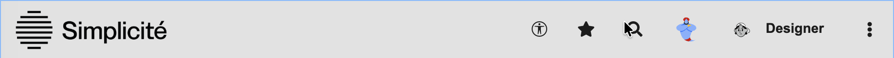
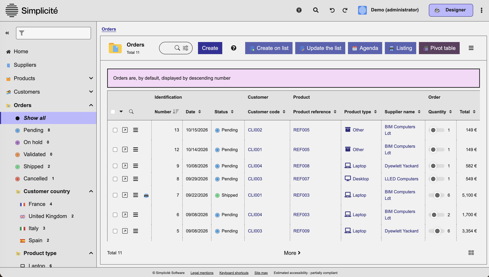
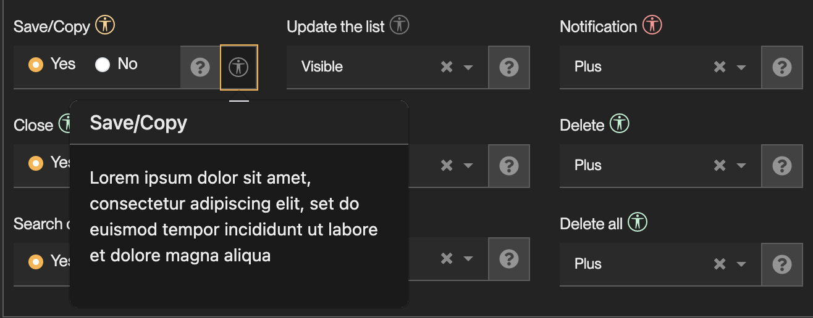

Create compliant applications with Simplicité
===========================================

Introduction
------------

This guide helps designers build Simplicité applications that meet the RGAA. It describes the tools the
platform provides to reach compliance, the platform-wide points that depend on your choices, and the
settings that a strictly compliant application requires.

It is meant to be used alongside the platform: keep it open while you configure your application.

Platform features
-----------------

| Feature | For | Purpose |
| --- | --- | --- |
| [`a11y-mode`](#runtime-a11y-mode) | End users | Runtime switch to the most RGAA-compliant version of the platform |
| [`ACCESSIBILITY_OVERRIDE`](#user-accessibility_override-parameter) | End users | Fine-tune which adaptations `a11y-mode` applies |
| [`ACCESSIBILITY_DEV`](#designer-accessibility_dev-sysparam) | Designers | Show the compliance status of each feature while you configure it |
| [`ACCESSIBILITY_LEVEL`](#accessibility-declarations) | Designers | Declare the accessibility level of your application |

### Runtime `a11y-mode`

End users toggle **Accessibility Mode** from the `.btn-a11y-mode` button in the application header.






Some core behaviors cannot be made compliant without degrading the comfort of users who do not need
them. `a11y-mode` adapts or disables them all at once, which makes it the most RGAA-compliant version
of the platform: in an audit, only use with `a11y-mode` on is guaranteed compliant for core elements.

| Behavior | What `a11y-mode` does |
| --- | --- |
| Custom colors of action buttons and states | All custom colors set on action buttons with the `act_bg_color` and `act_color` fields (Action form) |
| Horizontal menu | Forces all domains to be rendered on the left, disabling any `obd_menu` set to `T`. |
| Splitting the work area into resizable panels | Forcing the mono-area for the `#work`, and disabling the `btn-ui-splitter` so work-areas cannot be triggered. |
| Compact mode | Forcing the default compact setting (removing `compact` from the body), disabling the `zoom-compact` toggle. |
| Mosaic display of lists | Disabling all `btn-minifiable` in the lists `panel-footer`. Making them non-clickable when in a11y-mode. |
| Trays (trello) and metrics of status-based objects | Removing the statuses objects "Trays" (`status-tray`) and "Metrics" (`status-metrics`) entries from menu. |
| Predefined searches offered in the search dialog | Disabling the `predef` button from the search modal. |
| Date pickers | Removing all datetime pickers from fields and filters. Replacing them with a textual hint with proper formatting. |
| HTML input fields | Rendering all "complex" html fields as plain `textarea`, removing the specific features (linting, formatting, etc), but still allowing their usage. |
| Forced `HighContrast` theme | When in `a11y-mode`, switches the theme to be **HighContrast** (requires few settings to be effective, see [A11y-mode settings](#settings-for-a11y-mode)) |
| Opening a form per table row | Replaces the form-opening behavior from clicking on a row to an action button in the `col-action` of every row. |
| Default display of linked objects | Forces the `objlinks` display to be `objlinks-flow`, and disables the `btn-options` dropdown/action. |

:::warning

`a11y-mode` is a safety net: it does not make Non-Compliant features compliant. Under strict
requirements, disable them at design time, whether or not users turn the mode on.

:::

### User `ACCESSIBILITY_OVERRIDE` parameter

`a11y-mode` is all-or-nothing, so that it can reach full compliance. Users who do not need some of its
adaptations, or who want to keep some features anyway, can override it behavior by behavior with the
`ACCESSIBILITY_OVERRIDE` user parameter. Each key takes `true` or `false`:

```json
{
  "customcolors": false, // custom colors of action buttons and states
  "menutop": false,      // horizontal menu
  "workareas": false,    // splitting the work area into resizable panels
  "trays": false,        // trays (trello) of status-based objects
  "metrics": false,      // metrics of status-based objects
  "datepicker": false,   // date pickers
  "htmledit": false,     // HTML input fields
  "codeedit": false,     // code editors
  "highcontrast": false, // forced HighContrast theme
  "clickablerow": false, // opening a form per table row
  "flatlinks": false     // default display of linked objects
}
```

Each overridden behavior falls back to its standard, potentially non-compliant version for that user.

### Compliance statuses

The same vocabulary is used by the `ACCESSIBILITY_DEV` icons, by the `fld_compliance` field and across
this document.

| Status | Icon | `fld_compliance` | Meaning |
| --- | --- | --- | --- |
| **Compliant** <rgaa-c>(C)</rgaa-c> | green | `C` | Use freely. The feature meets the RGAA tests and WAI-ARIA rules. |
| **Partially Compliant** <rgaa-pc>(PC)</rgaa-pc> | orange | `PC` | Usable, but only with the settings given in its help popup (`fld_compliancehint`). |
| **Non-Compliant** <rgaa-nc>(NC)</rgaa-nc> | red | `NC` | Do not use under strict compliance requirements. |
| **Not Evaluated** | grey | `NE` | Not assessed yet. Avoid under strict requirements. |
| **Not Applicable** | none | `NA` | The feature has no bearing on RGAA compliance. |

### Designer `ACCESSIBILITY_DEV` sysparam

Set the `ACCESSIBILITY_DEV` system parameter to `yes` for the whole design phase. Every setting in the
configuration forms then shows an icon next to its label, giving the
[compliance status](#compliance-statuses) of the related feature where you make the choice.



- **No icon**: the feature has no bearing on RGAA compliance.
- **Grey icon**: not evaluated yet. Treat it as Non-Compliant under strict requirements.
- **Red / orange / green icon**: Non-Compliant / Partially Compliant / Compliant.
- On **orange** icons, a help popup lists the settings and precautions required to use the feature compliantly.

### Accessibility declarations

Once your application is built, declare its accessibility level with the `ACCESSIBILITY_LEVEL` system
parameter. It is displayed in the application footer.

```json
{
  "audit": false,
  "score": 60
}
```

- `audit`: `false` for an estimate by your team, the footer then reads **Estimated accessibility**.
  `true` for the result of an official audit, the footer then reads **Accessibility**. Without an
  audit, the law forbids claiming a guaranteed level.
- `score` (0 to 100): `100` is labelled _Fully Compliant_, `50` and above _Partially Compliant_, below
  `50` _Non Compliant_.

The example above displays **Estimated accessibility: partially compliant**.

Platform-wide considerations
----------------------------

These are not settings to apply, but things to know about the platform as a whole: where its
compliance ends, and where it depends on your design choices or on your end users. Keep them in mind
across the whole application.

### Themes and contrast

The **HighContrast** theme, shipped with the platform in light and dark variants, is the reference
compliant theme. It is the theme `a11y-mode` forces, whatever theme the application uses otherwise.

Colors are fully variabilized. If you create and use a custom theme, the platform can no longer
guarantee the criteria on colors, contrast and shapes: validate every color with the built-in contrast
checker available at each customization point.

Themes do not change the layout. If your custom theme does (custom CSS on sizes, spacing, positioning,
etc.), the platform can no longer guarantee the criteria on presentation and readability either.

Criteria whose compliance relies on the `HighContrast` theme:

- [Colors](/docs/accessibility/compliance.md#3-couleurs): 3.2 and 3.3, contrast of texts and of interface components;
- [Presentation of information](/docs/accessibility/compliance.md#10-présentation-de-linformation): 10.6, visibility
  of links, and 10.7, visibility of the focus.

A custom theme that changes the layout also puts the rest of theme 10 at stake (text resizing, information
given by shape, size or position, reflow).

### Custom HTML

Several extension points let you inject markup the platform does not control: static texts, field help
content, publication templates, JavaScript addons and external objects. Plain text is always safe. As
soon as you write HTML, its compliance is entirely yours - see the [resources](#resources) for the
WAI-ARIA rules to follow.

External objects are the extreme case: their markup is written in free code and cannot be checked at
all by the platform.

### Images

Each image exposes two user-editable texts:

- `alt`, its text alternative;
- `longdesc`, a detailed description attached to the image as screen-reader-only text, and visible to
  everyone while `a11y-mode` is on.

The platform provides the mechanism, but compliance depends on end users writing accurate texts, or
explicitly marking images as decorative. Say so in your application's own user documentation.

Charts: the platform's default **Crosstab** component is compliant, as it always offers a table
alternative to its charts. Other charts (ChartJS in external objects) are not: provide an accessible
alternative yourself (data table, textual summary). The same goes for diagrams and infographics.

### Languages and translations

The platform provides a translation system, but not multilingual content: an application displays one
language at a time, and changing the language switches the whole application.

Use the translation system properly: criteria requiring relevant labels, titles and alternatives are
only met if every text is translated in the active language. An untranslated text produces a change
of language the platform cannot declare in the markup.

Values entered by users (inputs, social posts, chats, etc.) cannot be detected as another language
when they are. Their language change cannot be declared either.

### PDF Publications

PDF publications are generated from HTML templates written by the designer, so their structure is
partly yours. Tick `prt_accessible` on the publication to have the PDF tagged to the PDF/UA-1
standard, and follow the [accessible PDF guide](/docs/integration/publications/pdf#accessible-pdf) when
writing the template.

Component guides
----------------

<!-- TODO: rework (component by component: settings to apply, features to avoid) -->

<!-- AHE:  Here the idea is to introduce with smth like "we map the settings like the user can see them in the interface, so MENU > FORM > FIELD.
With the field being named and its value being given & explained" Also if there is nothing relevant to set we skip the menu.
In a form we only include the "direct" settings, so the fields, and the "linked objects" 's fields ONLY if they have something relevant inside.
-->

<!--
| Field | Compliance | Value | Justification |
| - | - | - | - |
| `` | __ | __ | __ |
| `` | __ | __ | __ |
-->

> **Business objects** menu

### Domains

| Field | Compliance | Value | Justification |
| - | - | - | - |
| `obd_name` (Code) | NA | | |
| `obd_domain_id.obd_name` (Parent domain) | PC | | The parent domain needs to be compliant. |
| `row_module_id.row_mdl_name` (Module Name) | NA | | |
| `obd_icon` (Icon) | C | | |
| `obd_nohome` (Hide the home page) | NA | | |
| `obd_view_id.viw_name` (Home page) | PC | | The homepage has to be implemented and compliant (see the [view guide](#views)). |
| `obd_menu` (Menu position) | PC | **Left** | The menu-top is not compliant, and should anyway be disabled through `MENU_SETTINGS` (see [settings for RGAA](#settings-for-strict-rgaa-requirements)). |
| `obd_order` (Order) | NA | | |
| `obd_comment` (Description) | NA | | |

#### Domain translation

| Field | Compliance | Value | Justification |
| - | - | - | - |
| `tsl_object` (Object) | NA | | |
| `row_module_id.row_mdl_name` (Module Name) | NA | | |
| `tsl_lang` (Language) | C | | The language value is properly mapped to the selected session/user's interface. |
| `tsl_value` (Translation) | PC | | The value should be written in the _tsl_lang_'s language, and be relevant for the menu entry, as much as it should be legible. |
| `tsl_help` (User help) | NA | | |

### Business Object

**DESIGN**  

| Field | Compliance | Value | Justification |
| - | - | - | - |
| `obo_name` (Code) | NA | | |
| `obo_extend_id.obo_name` (Extend of logical name) | PC | | The parent object must be compliant (mostly related to having compliant fields). |
| `obo_dbtable` (Table) | NA | | |
| `obo_script_id` (Source code) | PC | | The script shouldn't implement features/behaviors listed as NC in this document, and if it contains any text then they have to be relevant regarding their context and properly translated. |
| `obo_rowid_id.fld_name` (Id field logical name) | NA | | |
| `row_module_id.row_mdl_name` (Module Name) | NA | | |
| `obo_comment` (Description) | NA | | |
| `obo_searchspec` (Filter) | C | | |
| `obo_prefix` (Prefix) | NA | | |
| `obo_role` (Type) | NA | | |
| `obo_class` (Class) | NA | | |
| `obo_exportorder` (Export order) | NA | | |

**FORM**  

| Field | Compliance | Value | Justification |
| - | - | - | - |
| `obo_template_id.tpl_name` (Template name) | PC | | The created/associated template must be compliant, see [templating](#templating) for further information/guidance. |
| `obo_icon` (Icon code) | C | | |
| `obo_title` (Additiv title) | PC | | If not empty, the selected title should follow any compliant text's rules ; be translated in all languages allowed by the application, be relevant and legible. |
| `obo_useform` (Use form) | PC | | The asociated form (template from _obo_template_id.tpl_name_) must be compliant. |
| `obo_dfltref` (Default panel) | NA | | |
| `obo_viewmode` (View mode) | PC | **Expanded** | Any value is supposably compliant, but to guarantee a strong page structure and understanding for ATs, the `a11y-mode` forces the value as **Expanded**. |

**LIST**  

| Field | Compliance | Value | Justification |
| - | - | - | - |
| `obo_pagine` (List pagination) | C | | |
| `obo_selrows` (Select rows) | C | | |
| `obo_minrows` (Min rows) | NA | | |
| `obo_maxrows` (Max rows) | NA | | |
| `obo_listedit` (Editable list) | PC | **Create on form** / **Create on list (single)** / **Editable list** | The fully editable list _Create + Update + Delete_ is not compliant (complex combo of a table and form). And the loop creation is not compliant because of the concurrent update/reload of the list. |
| `obo_refcount` (Reference count) | NA | | |
| `obo_list_areas` (Show areas on list) | PC | | The name and translations of the areas needs to be relevant in the list context, see [accessible texts](#accessible-texts). |
| `obo_tree` (Tree list) | NC | **No** | |
| `obo_groupby` (Allows to group by) | C | | |
| `obo_minifiable` (List minifiable) | NC | **No** | |
| `obo_minified` (List minified) | NC | **No** | |
| `obo_tpl_list_id.tpl_name` (List template) | NC | **empty** | |
| `obo_tpl_list_id.tpl_ncontext` (List template context) | NA | | |

**SEARCH**  

| Field | Compliance | Value/Hint | Justification |
| - | - | - | - |
| `obo_listsearch` (Enable search in list) | C | | |
| `obo_sortable` (Sortable fields) | C | | |
| `obo_search_column` (Show search in column) | PC | | Compliant as long as the search is not enabled on special/complex typed fields (HTML, notepad, etc). |
| `obo_search_dialog` (Use the search popup) | C | | |
| `obo_srh_predef` (Preset search) | NC | **none selected** | |
| `obo_search_index` (Show indexed search) | NA | | |
| `obo_search_docked` (Show docked search) | NC | **No** | |
| `obo_search_ts` (Timestamp search) | NC | **none selected** | |
| `obo_indexable` (Indexable) | C | | |
| `obo_indexed_fields` (Indexed fields) | NA | | |
| `obo_tpl_search_id.tpl_name` (Search template) | PC | | The associated template must be compliant on its own, see [templating](#templating). |
| `obo_tpl_search_pos` (Position) | PC | **Top** | Only the top position guarantees that the responsive handling is compliant. |

**OPTIONS**  

| Field | Compliance | Value/Hint | Justification |
| - | - | - | - |
| `obo_usets` (Timestamp) | NA | | |
| `obo_updall` (Bulk update) | NC | **No** | |
| `obo_copy` (Copy enabled) | C | | |
| `obo_delall` (Bulk delete) | C | | |
| `obo_export` (Data export) | C | | |
| `obo_historic` (Data history) | PC | **History table** / **Social post** / **Change log** | Most of the choice here are compliant as long as the users input texts that follow the rules (language and relevancy). |
| `obo_tray` (Tray menu) | NC | **No** | |
| `obo_print` (Printable) | C | | The created publication has to be compliant, see [publications](#publications). |
| `obo_dashboard` (Dashboard) | NC | **none selected** | |
| `obo_followlink` (Follow links) | C | | |
| `obo_distinct` (Distinct) | NA | | |
| `obo_mergeable` (Mergeable) | NC | **No** | |
| `obo_social` (Social post) | C | | |
| `obo_permalink` (Permalink) | NA | | |

**BUTTONS**  

| Field | Compliance | Value/Hint | Justification |
| - | - | - | - |
| `obo_btn_save` (Save) | C | | |
| `obo_btn_copy` (Copy) | C | | |
| `obo_btn_reload` (Reload) | C | | |
| `obo_btn_saveclose` (Save/Close) | C | | |
| `obo_btn_listadd` (Create on list) | C | | |
| `obo_btn_pref` (Preferences) | C | | |
| `obo_btn_savenew` (Save/New) | C | | |
| `obo_btn_listedit` (Edit list) | C | | |
| `obo_btn_bookmark` (Bookmarks) | C | | |
| `obo_btn_savecopy` (Save/Copy) | C | | |
| `obo_btn_listupsert` (Update the list) | NC | **Hidden** | |
| `obo_btn_export` (Notification) | C | | |
| `obo_btn_close` (Close) | C | | |
| `obo_btn_updall` (Bulk update) | NC | **Hidden** | |
| `obo_btn_del` (Delete) | C | | |
| `obo_btn_searchform` (Search on form) | C | | |
| `obo_btn_merge` (Merge) | NC | **Hidden** | |
| `obo_btn_delall` (Delete all) | C | **Hidden** | |

#### Object translation

| Field | Compliance | Value | Justification |
| - | - | - | - |
| `tsl_object` (Object) | NA | | |
| `row_module_id.row_mdl_name` (Module Name) | NA | | |
| `tsl_lang` (Language) | C | | The language value is properly mapped to the selected session/user's interface. |
| `tsl_value` (Translation) | PC | | The value should be written in the _tsl_lang_'s language, and follow the necessary rules about texts within the platform, see [accessible texts](#accessible-texts) |
| `tsl_plural_value` (Plural translation) | PC | | Same as above for _tsl_value_. |
| `tsl_help` (User help) | PC | | This field is populated thanks to _Quill_ and thus should follow the rules for its result to be accessible, see [quill fields](#quill-fields) |

#### Contextual help

| Field | Compliance | Value | Justification |
| - | - | - | - |
| `och_object_id.obo_name` (Object code) | NA | | |
| `och_context` (Context) | C | | All contexts can be chosen, as this message will be rendered as a casual text. |
| `och_lang` (Language) | C | | |
| `och_help` (Help) | PC | | The value should be written in the _och_lang_'s language, and follow the necessary rules about texts within the platform, see [accessible texts](#accessible-texts) |
| `row_module_id.row_mdl_name` (Module Name) | NA | | |

:::warning

All the linked objects must be compliant, and if they are listed further in this document, follow the explained rules and conditions.

:::

### Field

| Field | Compliance | Value | Justification |
| - | - | - | - |
| `fld_name` (Logical name) | NA | | |
| `row_module_id.row_mdl_name` (Module Name) | NA | | |
| `fld_dbname` (Physical name) | NA | | |
| `fld_default` (Default value) | NA | | |
| `fld_comment` (Description) | NA | | |
| `fld_deprecated` (Deprecated) | NA | | |

**TYPE**  

| Field | Compliance | Value | Justification |
| - | - | - | - |
| `fld_type` (Type) | PC | All types _but_ **Validated text**, **HTML content**, **Notepad**, **Geographical coordinates**, **Color**, **Object**, **External File**, **Password** | The only non-compliant field types are those, but even within the compliant types, some renderings are not. |
| `fld_size` (Width) | C | | For any limit that is set, it is announced with the `maxlength`attribute. |
| `fld_type_id.flt_code` (Validation type) | PC | | This is only compliant if you populate the field's inline help explaining what format is expected. |
| `fld_fromdate_id.fld_name` (Start date field) | NC | **empty** | Even with populating the field's help, this would require more specific linkage that isn't implemented. |
| `fld_list_id.lov_name` (List of values) | PC | | Compliant only if the associated list of values is compliant itself, see [list of value](#list-of-values). |
| `fld_precision` (Precision) | NC | **empty** | Whatever precision is written here won't be properly announced on the field. |
| `fld_minsize` (Minimum size) | C | | Same as for _fld_size_. |
| `fld_classification` (Classification) | NA | | |
| `fld_anon` (Anonymizable) | NA | | |
| `fld_calc` (Calculated expression) | NA | | |

**OPTIONS**  

| Field | Compliance | Value | Justification |
| - | - | - | - |
| `fld_fonctid` (Functional key) | NA | | |
| `fld_required` (Required) | C | | Required set fields are properly announced whatever the context is (form, list, process, etc). |
| `fld_updatable` (Updatable) | C | | All update contexts are compliant. |
| `fld_copy` (Copy enabled) | C | | |
| `fld_indexable` (Indexabe) | C | | |
| `fld_updall` (Bulk update) | NC | **No** | As the _Business Object_'s bulk update is non-compliant. |
| `fld_autocomp` (Auto-completion) | C | | Autocompletion is properly announced with the `autocomplete` attribute, and the helper dropdowns are compliant. |
| `fld_listsum` (List summation) | | | |
| `fld_groupby` (Allows to group by) | C | | Lists with groupby have the required `aria-expanded` attribute and a compliant DOM. |
| `fld_exportable` (Exportable) | | | |
| `fld_incrementsyntax` (Auto-increment syntax) | NA | | |
| `fld_compliance` (RGAA compliance) | C | | Everything generated by this field (indicator, tooltip, addon) are compliant and properly announced. |
| `fld_clipboard` (Clipboardable) | C | | Both the clipboard addon and the result toast are compliant. |

**DISPLAY**  

| Field | Compliance | Value | Justification |
| - | - | - | - |
| `fld_visible` (Visible) | C | | Fields' display in any context is handle compliantly, as long as the field is of a compliant _fld_type_. |
| `fld_more` (Extended) | C | | The more/less mechanism is fully compliant with `aria-expanded` and compliant behavior for hiding/showing fields. |
| `fld_research` (Search enabled) | C | | The search is compliant only for the compliant values of _fld_type_. |
| `fld_listmore` (Extended on lists) | C | | Same as for _fld_more_. |
| `fld_reqsearch` (Required search) | PC | **Non required** / **Required** / **Extended** | The _Semi-required_ cannot be properly flagged with ARIA attributes, and thus cannot be made compliant. |
| `fld_case` (Case) | NA | | |
| `fld_sort` (Sorting type) | C | | |
| `fld_righttoleft` (Right to left) | NC | **No** | The switch from left-to-right to right-to-left is not properly announced in the platform. |
| `fld_sort_nulls` (Order of nulls) | NA | | |
| `fld_speech` (Conversation) | NC | **none selected** | Speech recognition isn't compliant within the platform. |
| `fld_rendering` (Rendering) | PC | See [Fields rendering](#fields-rendering) | See [Fields rendering](#fields-rendering) |

#### Fields rendering

| Field type | Rendering | Compliance | Justification |
| - | - | - | - |
| **Short text** | _empty_ | C | |
| | QRCode/barcode scanner | NC | |
| | Icon picker | NC | |
| **Long text** | _empty_ | C | |
| | Expression | | |
| | Fixed font | | |
| | Text editor / CSS / HTML / SQL / JSON / Javascript / Markdown | PC | Ace component is not compliant, but if you really need this type of field, the _accessible mode_ turns them into plain `textarea`. |
| | Grid | NC | |
| | Count characters | NC | |
| | AI | NC | |
| **Integer** / **Decimal (double)** / **Decimal (100,32)** | _empty_ | C | |
| | Simple number | C | |
| | Monetary | C | |
| | Progress bar | NC | |
| | Percentage | C | |
| | Stars | NC | |
| | Slider | C | |
| | € / K€ / M€ / $ / K$ / M$ / ¥ / K¥ / M¥ / CHF | C | the created addon is properly declared/associated to the field. |
| **Date** / **Date and time** | _empty_ | PC | Pickers are not compliant, but _accessible mode_ removes them and replaces them with a hint and formatting logic. |
| | To year | C | Format is well taken into account in _accessible mode_ |
| | To month | C | idem |
| | To day | C | idem |
| **Time** / **Date and time** | _empty_ | PC | Pickers are not compliant, but _accessible mode_ removes them and replaces them with a hint and formatting logic. |
| | To hour | C | Format is well taken into account in _accessible mode_ |
| | To minute | C | idem |
| | To seconds | C | idem |
| **Enumeration** / **Multiple enumeration** | _empty_ | C | |
| | Single or multiple selection list | C | |
| | Horizontal / Vertical | C | |
| | Select with search (pillbox) | NC | |
| **Boolean** | _empty_ | C | |
| | Two radio buttons | C | |
| | Single checkbox | C | |
| | Combobox | C | |
| | Slide button | C | |
| **URL** / **Email** / **Phone number** | _empty_ | C | |
| | Icon on list | NC | |
| | Value | C | |
| | QRCode/barcode scanner | NC | |
| **Document** | _empty_ | C | |
| | Single document with icon on list | C | |
| | Single document name | C | |
| | Multi-documents boxes | NC | |
| | Multi-documents list | NC | |
| **Internal ID** | _empty_ | C | |
| | Popup picker | C | |
| | Select dropdown | C | |
| | Popup and select | C | |
| **Image** | _empty_ | C | |
| | Take a selfie | NC | |
| | Take a picture | NC | |
| | Signature pad / _ inlined | NC | |
| | Scratch pad / _ inlined | NC | |

### Actions

| Field | Compliance | Value | Justification |
| - | - | - | - |
| `act_name` (Name) | NA | __ | __ |
| `act_order` (Order) | NA | __ | __ |
| `act_comment` (Description) | NA | __ | __ |
| `row_module_id.row_mdl_name` (Module Name) | NA | | |

**ACTION CONFIGURATION**  

| Field | Compliance | Value | Justification |
| - | - | - | - |
| `act_type` (Type) | C | | All rendered buttons are compliant and announce the action in the same way. |
| `act_plus` (Plus menu) | C | | The plus menu dropdown is compliant, and the action is announced the same if within it. |
| `act_group_id.acg_name` (Group) | NA | | |
| `act_count` (Count rows) | NC | **No** | The badges aren't proeprly announced with the action in its accessible name. |
| `act_exec` (Execution) | NA | | |
| `act_async` (Asynchronous?) | NA | | |

**CONFIRMATION**  

| Field | Compliance | Value | Justification |
| - | - | - | - |
| `act_confirm` (With confirmation) | C | | The confirmation modal is compliant on its own, but must be considered if what it contains is not compliant. |
| `act_confirm_expr` (Condition) | NA | | |
| `act_confirm_ui` (UI template) | PC | | Compliant only if the HTML is compliant (see [accessible html](#accessible-html)) and including only compliant fields. |

**STYLE**  

| Field | Compliance | Value | Justification |
| - | - | - | - |
| `act_color_bg` (Background) | PC | | You can customize the colors with help from the embedded contrast checker, but it's recommended to not customize your actions' colors. Because if you do then depending on the context of the button (list, form, etc), the container background might change and not be contrasted enough. |
| `act_color` (Text color) | PC | | idem |
| `act_image` (Image) | C | | The image will be displayed as "decorative" with `aria-hidden`, so you mustn't think it as sole carrier of information. |

#### Action field

<!-- TODO -->

#### Action translation

| Field | Compliance | Value | Justification |
| - | - | - | - |
| `tsl_object` (Object) | NA | | |
| `row_module_id.row_mdl_name` (Module Name) | NA | | |
| `tsl_lang` (Language) | C | | The language value is properly mapped to the selected session/user's interface. |
| `tsl_value` (Translation) | PC | | The value should be written in the _tsl_lang_'s language, and be relevant for the menu entry, as much as it should be legible. |
| `tsl_simplehelp` (User help) | NA | | |

### Links

**PARENT OBJECT**  

| Field | Compliance | Value | Justification |
| - | - | - | - |
| `obf_ref_object_id.obo_name` (Main object) | NA | | |
| `obf_ref_order` (Link order) | NA | | |
| `obf_field_id.fld_name` (Reference) | NA | | |
| `row_module_id.row_mdl_name` (Module Name) | NA | | |

**CHILD OBJECT**  

| Field | Compliance | Value | Justification |
| - | - | - | - |
| `obf_object_id.obj_name` (Linked object) | C | | The generated panel is compliant as long as the object's list/form are compliant, see [templating](#templating) for the form. |
| `obf_card` (Cardinality) | NA | | |
| `obf_cascade` (Deletion) | C | | The triggered toasts/popups are properly announced. |
| `obf_anon` (Anonimizable) | NA | | |
| `obf_query` (SQL specification) | NA | | |
| `obf_filters` (Filters) | C | | The applied filters are properly announced on the lists/searches. |

**OPTIONS**  

| Field | Compliance | Value | Justification |
| - | - | - | - |
| `obf_copy` (Cascade copy) | NA | | |
| `obf_visible` (Visible panel) | C | | The generated panel is compliant as long as the object's form is compliant. |
| `obf_ref_export` (XML export) | NA | | |
| `obf_associate` (Associate) | C | | The association action andmodal and list are all compliants, as long at the object to associate has a compliant list. |
| `obf_rendering` (Rendering) | PC | **empty** / **Child list** | Pillboxes aren't compliant throughout the platform. |
| `obf_treedepth` (Tree depth) | NA | | |
| `obf_inline` (Inline fields) | NC | | |
| `obf_redolog` (Reassemble updates history) | C | | Same as _obo_historic_. |

### List of values

### Constraints

#### Impacts

> **User interface** menu

### Shortcuts

### Views

### Templating

### Objects rendering

#### Publications

> **Business process** menu

### Business process

### Activity

#### Activity link

### State

#### State transition

Mandatory settings
------------------

### Settings for `a11y-mode`

In order to enable the `a11y-mode` and its overrides, there are few things to enable within your applications :

- associate the user parameter `ACCESSIBILITY_OVERRIDE`
- create a **Scope theme** to link the `HighContrast` theme to your scopes.

### Settings for strict RGAA requirements

For applications that have very strict RGAA requirements, or if the gap between a11y-mode and regular usage needs to be shortened.

<!-- TODO: list of the system parameters / general settings to enable or disable -->

| Setting | Value | Why |
| --- | --- | --- |
| `TODO` | `TODO` | TODO |

Good practices
--------------

<!--
    TODO: write list with hints/helps such as :
        - write ALL the required translations and helps
        - don't place more than 2 row-columns
        - write all your translations regardless of contexts
        - don't add-up elements horizontally
        - don't align the fields' input/label. keep them as a block 
        - populate your field helps whenever there is an expected format, limit, etc
        - RGAA restrictions can/will impact certain conception choices.
            - Ensure you grasp the restrictions spectrum.
-->

Rules to know & apply
---------------------

### Accessible texts

### Accessible HTML

### Quill fields

Appendix: keyboard accessibility
--------------------------------

<!-- TODO: check if this part (fge) is still up to date -->

This reference is worth copying into your own application's user documentation: end users have no
other way of discovering these shortcuts.

### Global

| Keys | Action |
| --- | --- |
| `TAB` | Focus the next element in DOM order |
| `SHIFT` + `TAB` | Focus the previous element in DOM order |
| `ESC` | Close, by priority: the focused field or rich editor, then all modal dialogs, then the current form. Navigates back when nothing is focused |
| `ALT` + `H` | Display the **Home** page |
| `ALT` + `M` | Focus the main **Menu**, on the last selection or the first item |
| `ALT` + `W` | **Wide** screen, toggling the menu |
| `ALT` + `B` | Open the **Bookmarks** dialog |
| `ALT` + `F` | Focus the **Finder**, the global search in the header |
| `ALT` + `L` | Focus the first visible **List** |
| `ALT` + `N` | Focus the **Next** visible area or list, on the first `.js-focusable` element |

### Menu

| Keys | Action |
| --- | --- |
| `ALT` + `M` | Focus the main menu, on the last selection or the first item |
| `RIGHT` / `LEFT` | Open / close a domain or a sub-menu |
| `UP` / `DOWN` | Previous / next menu item |
| `ENTER` | Open the item, list or view, or launch a business process |

### Lists and forms

Horizontal navigation, after a search:

| Keys | Action |
| --- | --- |
| `SHIFT` + `LEFT` | Previous record on a form, previous page on a list |
| `SHIFT` + `RIGHT` | Next record on a form, next page on a list |
| `CTRL` + `SHIFT` + `LEFT` | First record on a form, first page on a list |
| `CTRL` + `SHIFT` + `RIGHT` | Last record on a form, last page on a list |

Vertical navigation within a page of a list:

| Keys | Action |
| --- | --- |
| `UP` / `DOWN` | Move across table rows: header row to focus columns and sort fields, search row to filter, then the records of the current page |
| `TAB` | Visit the focusable cells of a row. Long texts, markdown content and textareas are focusable so they can be scrolled with the arrow keys |
| `ENTER` | Open the record, when form access is granted for that row |

### Designer shortcuts

Shortcuts can define further access keys.

| Keys | Action |
| --- | --- |
| `ALT` + `I` | XML import page |
| `ALT` + `C`, then `C` | Clear all caches |
| `ALT` + `X` | Open the script / code editor |

Resources
---------

- [Our position on the RGAA criteria](/docs/accessibility/compliance.md) - the platform's verdict on each of the
  106 criteria, and what is expected of you as a designer.
- [Using ARIA](https://www.w3.org/TR/using-aria/)
- [ARIA in HTML](https://www.w3.org/TR/html-aria/)
- [ARIA Authoring Practices](https://www.w3.org/WAI/ARIA/apg/patterns/)
