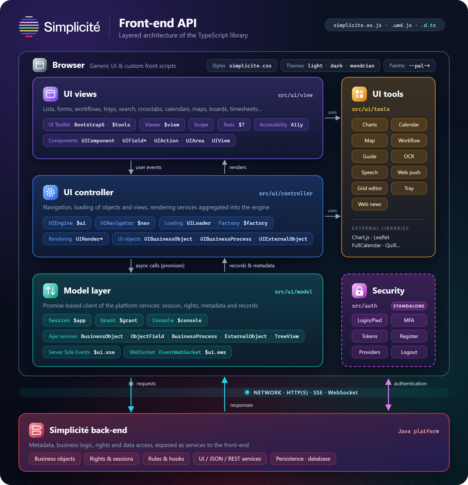

Ajax Library
============

:::warning

This documentation is part of the **Frontend Development** category, designed to guide you through frontend customization within Simplicité.

:::

This guide covers the core methods of the Ajax library and how they fit into Simplicité's MVC architecture.

MVC Architecture
----------------

Simplicité's frontend follows the **Model-View-Controller** pattern to keep applications organized and maintainable:

- **Model** (`$app`): Backend data handler via `Simplicite.Ajax`
- **View** (`$view`): UI components and rendering via `Simplicite.UI.View`
- **Controller** (`$ui`): Frontend engine coordinating Model and View via `Simplicite.UI.Engine`



Global Objects
--------------

The following global objects are available in Simplicité:

| Object   | Type                            | Description                 |
|----------|---------------------------------|-----------------------------|
| `$ui`    | `Simplicite.UI.Engine`          | Main UI Controller          |
| `$app`   | `Simplicite.Application`        | Ajax Service / Main Model   |
| `$view`  | `Simplicite.UI.View.Main`       | View Engine / Main View     |
| `$grant` | `Simplicite.Ajax.Grant`         | User rights and information |
| `$nav`   | `Simplicite.UI.Navigator`       | Navigation controller       |
| `$root`  | `String`                        | Server root URL             |
| `$tools` | `Simplicite.UI.View.Bootstrap5` | Bootstrap-specific methods  |
| `$T`     | `Function`                      | Text translation shorthand  |

### Access Shortcuts

Most of these objects can also be reached through `$ui`:

```javascript
$ui.app       // Same as $app
$ui.view      // Same as $view
$ui.grant     // Same as $grant (also $app.grant)
$ui.nav       // Same as $nav
$ui.view.tools // Same as $tools
```

Accessing Simplicité Session
----------------------------

### Core Methods

| Method                              | Returns                        | Description                                 |
|-------------------------------------|--------------------------------|---------------------------------------------|
| `$ui.getApp()`                      | `Simplicite.Ajax`              | Current Simplicité session (same as `$app`) |
| `$ui.getGrant()`                    | `Simplicite.Ajax.Grant`        | Current user rights (same as `$grant`)      |
| `$app.getGrant(params)`             | `Promise<Grant>`               | Reload the user rights from the server      |
| `$app.getView(name, params)`        | `Promise<View>`                | View definition by name                     |
| `$app.getUserInfo(login, params)`   | `Promise<Object>`              | User data (login, name, email, picture)     |
| `$app.getBusinessObject(obj, inst)` | `Simplicite.UI.BusinessObject` | Business object instance                    |

Manipulating Business Objects
-----------------------------

### Key Methods

| Method                        | Returns                              | Description                              |
|-------------------------------|--------------------------------------|------------------------------------------|
| `search(filters, params)`     | `Promise<Array<Object>>`             | Search items with filters                |
| `get(rowId, params)`          | `Promise<Object>`                    | Load one item                            |
| `getForCreate(params)`        | `Promise<Object>`                    | Load default item for creation           |
| `getForUpdate(rowId, params)` | `Promise<Object>`                    | Load item for update                     |
| `create(item, params)`        | `Promise<Object>`                    | Create and load new item                 |
| `update(item, params)`        | `Promise<Object>`                    | Update and load item                     |
| `save(item, params)`          | `Promise<Object>`                    | Create or update item                    |
| `del(item, params)`           | `Promise<Object>`                    | Delete item (or row ID)                  |
| `getCount(filters, params)`   | `Promise<Object>`                    | Row count with filters, set in `count`   |
| `getFields()`                 | `Array<Simplicite.Ajax.ObjectField>` | All object fields                        |
| `getField(name, id)`          | `Simplicite.Ajax.ObjectField`        | Specific field by name (and list row ID) |

### Business Object Structure

| Attribute | Description                                                    |
|-----------|----------------------------------------------------------------|
| `count`   | Current search result count                                    |
| `filters` | Current search filters (`filters.filterName`)                  |
| `item`    | Currently loaded item                                          |
| `list`    | Search result array of items                                   |
| `metadata`| Meta data (name, instance, fields)                             |

### Field Access Example

Data access methods such as `search` return a `Promise`:

```javascript
const product = $app.getBusinessObject("DemoProduct");

product.search().then(rows => {
    for (const row of rows) {
      console.log(row.demoPrdName); // Direct field access
      console.log(row.demoPrdSupId__demoSupName); // Linked field access
    }
});
```

Displaying UI Elements
----------------------

The following methods display UI elements (a `null` container is the work area):

| Method                                            | Description                          |
|---------------------------------------------------|--------------------------------------|
| `displayForm(ctn, obj, rowId, p, cbk)`            | Display form for object              |
| `displayList(ctn, obj, p, cbk)`                   | Display list for object              |
| `displaySearch(ctn, obj, p, cbk)`                 | Display search form for object       |
| `displayHome(ctn, p, cbk)`                        | Display the home page                |
| `displayView(ctn, view, p, cbk)`                  | Display a view by name               |
| `displayDashboard(ctn, name, p, cbk)`             | Display the user dashboard           |
| `displayTray(ctn, obj, field, p, cbk)`            | Display the trays of a state model   |
| `displayCalendar(ctn, obj, agenda, p, cbk)`       | Display an agenda                    |
| `displayCrosstab(ctn, obj, name, p, cbk)`         | Display a pivot table                |
| `displayTreeView(ctn, obj, rowId, name, p, cbk)`  | Display a tree view of a record      |
| `displayTimesheet(ctn, obj, rowId, name, p, cbk)` | Display a timesheet                  |
| `displayMap(ctn, p)`                              | Display records or a point on a map  |
| `displayWorkflow(ctn, pcs, action, p, cbk)`       | Start or resume a business process   |
| `displaySummary(ctn, obj, rowId, p)`              | Display the summary card of a record |
| `displayIndexSearch(ctn, req, p, cbk)`            | Display a full-text search result    |
| `displayExport(ctn, obj, rowId)`                  | Display the export dialog            |
| `displayPrint(ctn, name, obj, rowId, cbk)`        | Display a publication                |

**Example**:

```javascript
// A null container means the default work area
$ui.displayForm(null, "DemoProduct", rowId, {
    // "add": adds the form to the navigation history
    // "new": starts a new navigation
    // unset: leaves the navigation unchanged (e.g. the form is displayed in a view already in the nav)
    nav: "add"
});
```
